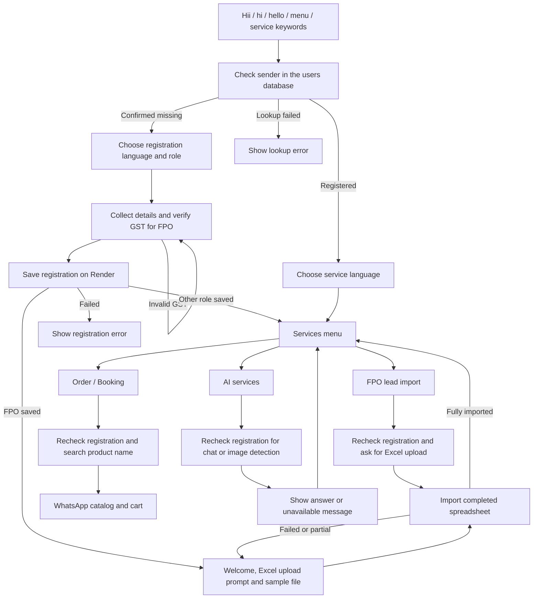

# Registration and services on one WhatsApp number

Import or save [`krishivan-unified.flow.json`](../krishivan-unified.flow.json) into the existing **Krishivan service chatbot**, ID `407fe203-a3a8-49bf-85d7-ea5e675b76d9`. The file uses only phone number ID **760184003848443** (`+91 83411 02043`).



The single trigger owns these keywords: `hii`, `hi`, `hello`, `hey`, `hii i need help`, `hii i want to register under`, `register`, `registration`, `menu`, `services`, `order`, `booking`, and `ai`. Every keyword starts the same database check and hub. Typing `menu` restarts that check; it does not submit an order. A keyword such as `order` opens the hub rather than automatically submitting a booking.

English, Hindi, and Telugu registration retain all eight supplied roles. After FPO registration, the original welcome is followed by **"Please Import excel file for onboarding fpo leads"** and the real **`fpo_leads_import_sample.xlsx`** attachment. The flow waits for the completed spreadsheet. After a fully successful import, the role summary is followed by the same services menu in the selected language. Failed or partial imports remain at the upload step. Other roles continue directly from their welcome to services. Existing users choose a service language. GST validation still uses the supplied AWS GST verification endpoint; registration, local user lookup, and catalog search use `https://console-api-z4hc.onrender.com`.

The exact English upload prompt is retained for all three FPO paths because the existing message sender recognizes it and attaches the sample. The English path reuses the original upload-question node. Order/booking, AI menus, catalog search, and cart processing retain their previous behavior.

FPO registration in English, Hindi, and Telugu asks for the GST number immediately after role selection. It does not ask for email. Registration can use the sender's phone number, and the welcome omits the email line when no email was supplied. Other roles retain their existing registration questions. Save the regenerated JSON into the existing chatbot to apply this question-order change.

When GST verification returns a usable company contact email, the flow includes it as `session_data.email` in the request to the Render API's `/v1/auth/stored-chat-session`. It is saved in `stored_session_data.data.email` and `users.email` and shown in the welcome. A valid user- or Excel-supplied email takes priority over GST email. GST `email`, `email_address`, and `email_id` fields are supported, including company details and the verification response's data object. Missing, blank, and masked GST emails do not add an email question or generate a substitute email. This fallback requires the backend update; it does not backfill existing registrations.

Registration stores role and language values in English in both the raw registration record and the user record. For example, `किसान` and `రైతు` become `farmer`; `हिंदी` becomes `hindi`, and `తెలుగు`/`తెలుగులో` become `telugu`. The welcome message, account field labels, role display, and login instructions follow the selected Hindi, Telugu, or English language. Company names, GSTIN, PAN, email, phone numbers, and user-entered names or addresses retain their original values. Deploy the changes to `utils.ts` and `auth.service.ts` to enable this behavior; the saved flow uses `{{registration_welcome}}` without requiring another import.

Location fields are taken from the Excel row or address data already supplied during registration. No geocoding service is used. The import accepts title-case headings such as `Mobile Number` and `Sub District`, as well as the sample's lowercase headings such as `phone_number` and `subdistrict`. Heading matching ignores spaces, underscores, hyphens, and capitalization.

| Excel field | Registration API field | PostgreSQL JSON field |
| --- | --- | --- |
| `state` | `state` | `location.state` |
| `district` | `district` | `location.district` |
| `subdistrict` / `Sub District` | `sub_distric` | `location.subdistrict` |
| `village` | `village` | `location.village` |
| `pincode` | `pincode` | `location.pincode` |
| `address` | `full_address` | `location.full_address` |

The API also receives these fields under `kyc_data.address`; `sub_distric` retains the external API's existing spelling. PostgreSQL stores them in `users.location` and `stored_session_data.data.location`, with state also populated in `users.state`. The existing JSON fields require no new database columns. Supplied coordinates are retained, including zero values, but missing address fields are never inferred from coordinates. Missing fields are omitted from the welcome message. Available fields are shown with English, Hindi, or Telugu labels and the original Excel values. Excel imports keep their existing role-summary response; this update does not add bulk welcome notifications.

The final request to `POST /prod/farmer-function/register-user` on the AWS API uses the same flat address schema for GST registration, Excel imports, and direct calls to `registerkrishivanUser`. Nested location fields are flattened before sending. Coordinates use GeoJSON `Point` order `[longitude, latitude]`, including when the input already contains a GeoJSON object. For example, the address portion is:

```json
{
  "full_address": "GWVM+V2 Vadapathy, Tamil Nadu, India",
  "pincode": "606108",
  "village": "cuddalore",
  "sub_distric": "Vadapathy",
  "district": "Cuddalore",
  "state": "Tamil Nadu",
  "coordinates": { "type": "Point", "coordinates": [78.93256254, 11.54462829] }
}
```

Database-generated properties such as `_id` and password hashes are not part of this address mapping. Updating this API client does not change the remote AWS Lambda implementation or backfill previously registered accounts.

Each booking, chat, image-detection, and FPO-import entry checks registration again. A click on an earlier WhatsApp service message therefore cannot bypass registration. Lookup errors never count as an unregistered user. Interactive IDs are included in edge JSON so they survive storage and regenerated node IDs.

Replies to a saved menu take priority over start keywords. In particular, clicking **Order / Booking** opens the product question and clicking **AI services** opens the AI options; their visible titles do not restart the welcome or language selection. This requires the backend routing fix in `chatbot.service.ts` and `trigger.logic.ts`. Existing edges using `button_id` or `sourceHandle` are supported. Typed greetings and unmatched keyword buttons can still start a flow. Deploying this fix preserves the stored service connections; no JSON reimport is needed solely to fix the restart loop.

## Store the flow

Deploy the accompanying backend change before saving this version of the flow: the spreadsheet webhook must call `resumeAfterFpoLeadImport` to advance a waiting upload question to services. The existing sample-file sender is reused. Run `npm run build` and deploy through your usual Render process. Preparing these changes did not deploy the backend or modify the live chatbot.

Use the existing bot instead of creating a second bot with the same keywords on this number. That bot already owns the published greeting keywords. Keeping registration and services in one graph avoids keyword conflicts and cross-bot session handoffs.

Send the entire JSON file as the body of:

```http
POST https://console-api-z4hc.onrender.com/v1/admin/chatbot/flow/407fe203-a3a8-49bf-85d7-ea5e675b76d9
Authorization: Bearer YOUR_ADMIN_JWT
Content-Type: application/json
```

[`krishivan-unified.flow.http`](../krishivan-unified.flow.http) contains the save and read-back requests. Set `adminToken` and run the save request. **The existing bot is published, so saving replaces its live nodes and edges immediately.** Existing conversations may need to send `Hii` to restart with the new nodes. No database or publishing changes were made while preparing these files.

Alternatively, use your flow editor's import function with the JSON, select number `760184003848443`, and save it into that same bot. If saving into another bot, first remove overlapping published keywords on this number through the normal chatbot controls.

## Booking and service prerequisites

- Booking uses catalog `795853123055079`, which exists for the company owning this number. The customer enters a product name, matching products open in a WhatsApp product list, and the native cart webhook submits the order using the existing order processor. Empty search results ask for another product name. The customer's database record must have a valid `parent_user_id` pointing to the FPO and a `role_id`; the existing order processor rejects incomplete mappings. Ordinary self-registration does not automatically assign an FPO. The existing `Hii I want to register under <FPO phone>` referral path remains available.
- FPO lead import uses the existing sample generator and spreadsheet webhook. A local copy is available at [`samples/fpo_leads_import_sample.xlsx`](samples/fpo_leads_import_sample.xlsx); replace the example rows with your own leads. WhatsApp automatically sends the same generated workbook immediately after the upload prompt. Upload the completed `.xlsx`, `.xls`, or `.csv` in the same conversation. The webhook handles and stores spreadsheet rows; the flow does not POST the file URL to the registration endpoint. On success it stores file metadata in the waiting session and resumes the services menu for the same customer and receiving number. Text, failed imports, and partial imports do not advance the upload question. Users can type `menu` to choose services without uploading immediately.
- **AI is wired but is not live on the selected host.** Live probes returned `404 Route not found` for `POST /api/ai/chat` and `POST /api/ai/image-detection`. This repository has no implementations of those routes. Deploy the AI handlers at those URLs or change their six HTTP nodes to working endpoints. Until then, selecting AI returns an unavailable message and the services menu.
- The AI nodes preserve the supplied request envelope, `{ "data": "{{variable}}" }`, which resolves to an object containing `phone_number`, `native_language`, `chat` or `image_url`, and available session details. The success branch expects `{ "success": true, "data": { "answer": "Text to show" } }`. Adjust the answer node and condition together if your AI API uses another response shape.
- Service results remain in chatbot session variables through the existing HTTP-node persistence. Service branches never call `/stored-chat-session`, which performs user registration. This prevents AI requests from registering the customer again. This change adds no separate service-history table.

## Validation

Rebuild the JSON with `node scripts/build-unified-flow.js`.

Run the focused tests with:

```powershell
node -r ts-node/register/transpile-only --test tests/unified-chatbot-flow.test.js tests/customer-registration-flow.test.js tests/registration-role.test.js tests/chatbot-trigger.test.js tests/chatbot-role-selection.test.js tests/order-processing.test.js tests/fpo-import-sample.test.js tests/fpo-import-continuation.test.js
```

The combined-flow tests execute the real node engine, message builders, and reply handler with mocked HTTP and persistence. They cover all 24 role/language combinations, the FPO upload step, sample-file message order, successful and failed spreadsheet webhook processing, continuation scoped to the receiving number, booking catalog messages, stale service replies, unavailable AI routes, and routing after storage remaps node IDs. Prior live checks verified the existing-user endpoint and confirmed the missing AI routes. No WhatsApp messages, registrations, or orders were submitted during validation; sample delivery, file uploads, catalog delivery and actual order creation still need a controlled WhatsApp acceptance test after deployment and saving.
